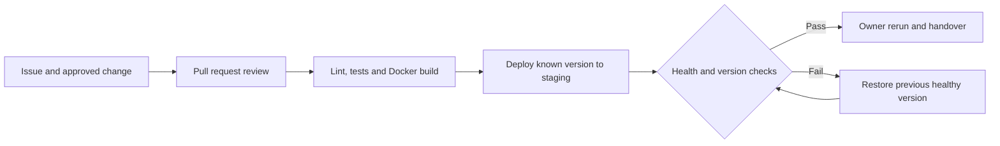

# Steady Deploy DevOps Labs

Practise CI repair, release and rollback, network troubleshooting and operational handover on the same Docker service. The default path uses Python, GitHub Actions and local Docker. The optional AWS and Azure paths provision isolated sandbox resources when a learner follows the live runbooks.

This is a fictional training project. The service serves a version and a health result. It holds no user data. The company operating templates and founder schedule are kept in a separate private repository.

## Start here

Use the [learning glossary](docs/learning-glossary.md) for the Git, Docker, AWS and security terms used in these labs.

| Lab | What you do | Evidence |
| --- | --- | --- |
| [01 · CI repair](docs/labs/01-ci-repair.md) | Reproduce a broken workflow on a branch, diagnose it and review the fix | Red and green runs, plus proof that failures still block delivery |
| [02 · Local release and rollback](docs/labs/02-local-release.md) | Release a healthy image, detect a candidate returning HTTP 503, then restore the verified baseline | Version, health, timings and a second operator’s rerun |
| [03 · AWS staging](docs/labs/03-aws-staging.md) | Use Terraform and ECS to observe release health, automatic rollback and state reconciliation | Task revision, ECS events, logs and cleanup |
| [04 · Azure staging](docs/labs/04-azure-staging.md) | Use Bicep and Azure Container Apps to isolate an unhealthy revision and restore traffic | Revision health, traffic weights, HTTP version and cleanup |
| [05 · Monitor and hand over](docs/labs/05-monitoring-handover.md) | Agree one health signal, reproduce a fault and write an actionable notification and handover | Failure signal and another operator’s response |
| [06 · Dependency security](docs/labs/06-dependency-security.md) | Interpret a real advisory and prove a temporary affected inventory is rejected | Advisory match, fixed-version rerun and peer explanation |
| [07 · Operations troubleshooting](docs/labs/07-operations-troubleshooting.md) | Diagnose DNS, TCP and HTTP failures, then write a Bash or Python probe | Before/after checks, root cause, app logs and an independent rerun |

Run 01, 02 and 07 before opening live cloud labs. Start with the commands once, then repeat them manually and explain each result to your partner.

## Run the checks

Use Python 3.12, Docker with Compose v2, Git and a Bash shell. On macOS or Linux:

```bash
python3.12 -m venv .venv
source .venv/bin/activate
python -m pip install --require-hashes -r requirements.txt
python -m pip install ruff==0.17.5 pip-audit==2.10.1
ruff check .
ruff format --check .
python -m unittest discover -s tests -v
python -m pip_audit --disable-pip --require-hashes --strict --progress-spinner off -r requirements.txt
bash scripts/rehearse-local.sh
```

The local script needs port 18080, or set a different port such as `LAB_PORT=18081 bash scripts/rehearse-local.sh`. It removes the containers, network and image tags it created. The two service endpoints are `/healthz` and `/version`. The documentation shows how to run the same sequence without the script.

## Release path



GitHub Actions uses pinned actions and read-only repository permissions for checks. The rehearsal job uses local Docker on the GitHub runner without cloud credentials. Terraform and Bicep checks validate infrastructure definitions without applying them. The separate image workflow publishes only when manually requested from main.

## What to learn next

- Explain a dependency install failure, an intentional application test failure and an unhealthy deployment as three different incidents.
- Inspect and identify a release by an image digest, and retain a known-good version.
- Practise account selection, least privilege, cost checks, reviewing infrastructure changes and confirming cleanup before you take real client access.
- Add a client’s acceptance test only after agreeing what their team needs. Store private records separately from the practice repository.

[Architecture decision](docs/adr/0001-single-service-release-lab.md) · [Project context](context.md)
